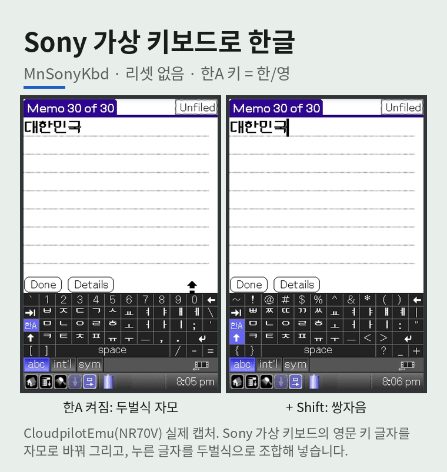
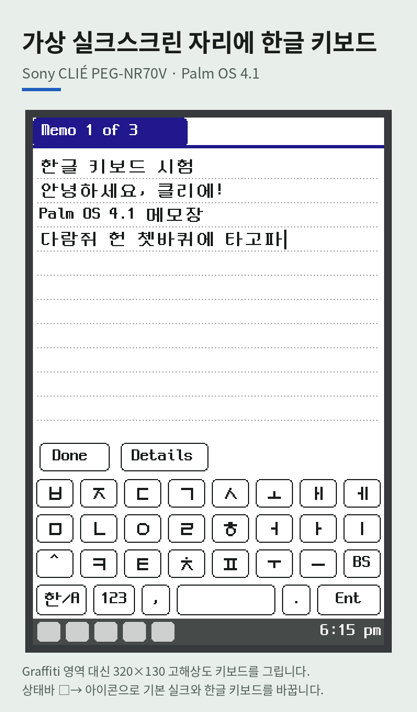
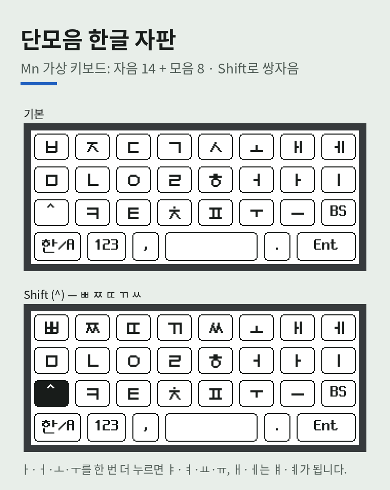
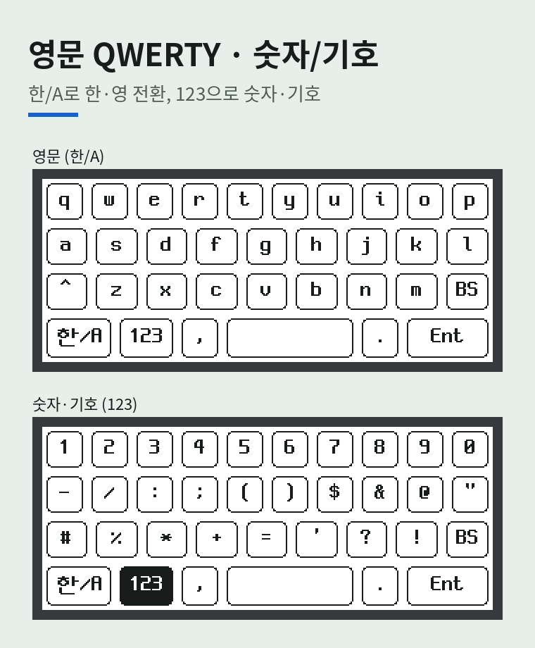
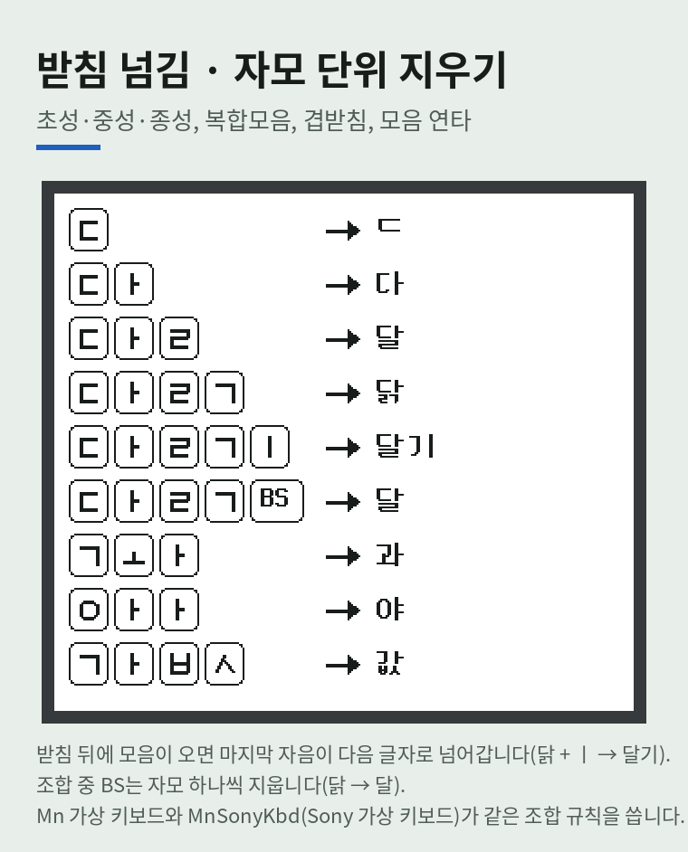
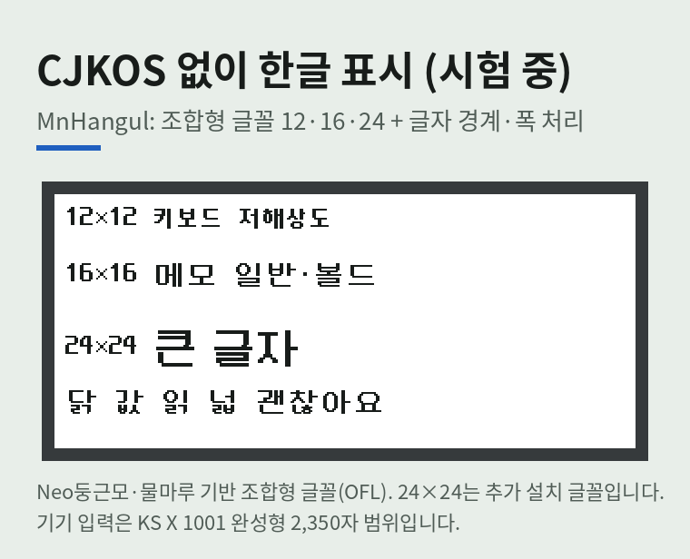

# clie-hangul-keyboard

Sony CLIÉ PEG-NR70V(Palm OS 4.1S)의 가상 실크스크린(Graffiti 영역) 자리에 한글 소프트 키보드를 띄우는 입력기.

- 목표 자판은 영문 QWERTY, 한글 단모음, 나랏글이다. 현재 영문 QWERTY와 **구글 단모음과 비슷한 한글 자판**의 입력·조합을 구현했고, **나랏글은 향후 구현 대상으로 개발을 보류**한다.
- 한글 **표시와 글자 처리는 현재 CJKOS에 의존**한다. CJKOS를 대체할 한글 처리 모듈은 시험 단계다([docs/KOREAN_SUPPORT.md](docs/KOREAN_SUPPORT.md)).
- 키보드 기능은 현재 동결(안정화) 상태다.
- **Sony 가상 키보드로도 한글을 쓸 수 있다**(시험 단계). `MnSonyKbd.prc`를 설치하면 리셋 없이, Sony 가상 키보드의 ⇪ 자리 `한A` 키로 한/영을 바꾸고 키 글자가 두벌식 자모로 바뀐다. CJKOS 등 한글 시스템이나 MnHangul과 같이 쓴다([아래](#sony-가상-키보드로-한글mnsonykbd)).
- 구성은 세 모듈이다: **한글 표시**(CJKOS 등, 또는 CJKOS 대체 `MnHangul`) × **키보드**(Mn 가상 키보드 `MnSkPlugin`+`MnSkCore`, 또는 Sony 가상 키보드 한글 `MnSonyKbd`).

## 목차

- [소개](#소개) — 화면 그림
- [용어](#용어)
- [현재 상태](#현재-상태)
- [배포 파일](#배포-파일)
- [설치·업데이트](#설치업데이트) — 리셋이 필요한 이유 포함
- [Sony 가상 키보드로 한글(MnSonyKbd)](#sony-가상-키보드로-한글mnsonykbd) — `한A` 키, 리셋 없음
- [제한사항](#제한사항)
- [문서](#문서)
- [시험 환경](#시험-환경)
- [빌드 환경](#빌드-환경)
- [test/hello.prc](#testhelloprc)

## 소개

<table>
<tr>
<td></td>
<td></td>
</tr>
<tr>
<td></td>
<td></td>
</tr>
<tr>
<td></td>
<td></td>
</tr>
</table>

첫 그림(Sony 가상 키보드)은 CloudpilotEmu(NR70V) 실제 캡처(MnHangul v50 — 같은 코드가 v54부터 MnSonyKbd, 시험 단계)다. 다시 만들기: `python3 tools/gen-readme-sony.py docs/images/capture-sony-base.png docs/images/capture-sony-shift.png`
나머지(Mn 키보드·MnHangul 글꼴)는 실제 캡처가 아니라 같은 자판 배치·자모 선 그림·조합형 글꼴 데이터로 다시 그린 것이라 실제 화면과 조금 다를 수 있다
(영문 글자는 Sony 글꼴 대신 픽셀 글꼴). 다시 만들기: `python3 tools/gen-readme-images.py <neodgm.ttf>`.

## 용어

| 용어 | 뜻 |
| --- | --- |
| 가상 실크스크린 | NR70V 화면 아래쪽에서 Graffiti 입력 영역과 상태바를 소프트웨어로 그리는 영역 |
| Graffiti | Palm OS의 필기 인식 입력 방식(그 입력 영역) |
| `SilkExtn` | NR70V ROM에 들어 있는 Sony의 실크스크린 제어 확장 모듈 |
| `SkWr` | `SilkExtn`이 부팅 때 찾아 호출하는 플러그인 DB의 타입 식별자 |
| 로더(Loader) | 부팅 때 `SilkExtn`에 등록되어, 키보드 본체에 이벤트를 넘겨주는 작은 프로그램(`MnSkPlugin.prc`) |
| 본체(Core) | 자판 그리기, 터치 판정, 한글 조합을 실제로 처리하는 프로그램(`MnSkCore.prc`) |
| PRC | Palm OS의 앱·코드·리소스를 담아 배포하는 데이터베이스 파일 형식 |
| CJKOS | 영문 Palm OS에서 한중일 문자 표시·입력을 지원하는 외부 소프트웨어 |
| Sony 가상 키보드 | NR70V 상태바 키보드 아이콘으로 여는 ROM에 들어 있는 Sony의 영문 키보드(`SilkExtn`). MnSonyKbd가 키 글자와 ⇪ 키를 바꿔 그린다 |
| Mn 키보드 | 이 저장소의 단모음 한글 키보드(`MnSkPlugin` + `MnSkCore`) |

## 현재 상태

| 기능 | 상태 |
| --- | --- |
| 가상 실크스크린 자리에 키보드 표시(고해상도 320×130) | 구현 완료 (런처·메모장·ClieDiag에서 실측) |
| 영문 QWERTY | 구현 완료 |
| 한글 단모음 (Shift 쌍자음, 모음 연타 ㅑㅕㅛㅠㅒㅖ) | 구현 완료, 안정화 단계 |
| 한글 조합: 초성·중성·종성, 복합모음, 겹받침, 받침 넘김, 조합 중 자모 단위 BS | 구현 완료 (메모장 실측, PC 조합 시험 41개 통과) |
| 숫자·특수문자 | 구현 완료 |
| Mn 키보드: 리셋 없는 본체(`MnSkCore`) 업데이트 / 리셋 1번 로더(`MnSkPlugin`) 업데이트 | 구현 완료 (CloudpilotEmu 실측) |
| Sony 가상 키보드 한글 (`한A` = 한/영, Shift 쌍자음, 키 글자 두벌식 자모 표시) | 시험 단계, 리셋 없음. MnHangul v50(CJKOS 없이)·v53 `Sony only`(CJKOS와 같이)로 메모장 실측. v54에 별도 모듈 `MnSonyKbd`로 분리(분리 판은 미시험) |
| 나랏글 | 개발 보류 |
| 키 반복 | 미구현 |
| CJKOS 대체 한글 지원 모듈 | 시험 단계: 시험 앱(MnHangul)으로 CJKOS 없이 메모장 실측 — 조합형 글꼴 그리기(12·16·24, 24는 추가 설치 글꼴), 글자 경계(글자 단위 BS·커서), 폭·줄바꿈. 설치 후 리셋 없이 `Patch ON`으로 바로 동작, `Auto: ON`이면 리셋 뒤 자동 시작(v25~v27, CloudpilotEmu 실측) |

## 배포 파일

| 파일 | 구분 | 역할 |
| --- | --- | --- |
| `bin/MnSkPlugin.prc` | A·C | 로더. `SilkExtn`에 등록되는 `SkWr` 플러그인(약 1KB)으로, 부팅 때 호출되어 키보드 본체와 연결한다 |
| `bin/MnSkCore.prc` | A·C | 키보드 본체(자판 그리기·터치 판정·한글 조합). 로더가 불러 실행한다 |
| `bin/MnHangul.prc` | C·D | 한글 표시 모듈(시험 단계). 한글 시스템(CJKOS 등)이 없을 때 한글 표시 |
| `bin/MnHgFont24.prc` | C·D 선택 | MnHangul 24×24 추가 글꼴(큰 글꼴용) |
| `bin/MnSonyKbd.prc` | B·D | Sony 가상 키보드 한글(시험 단계). `한A` 한/영, 두벌식 입력, 키 글자 자모 표시. 한글 표시는 하지 않는다 |
| `bin/ClieDiag.prc` | 선택 | 키보드 상태 확인(로더·본체 빌드, 불러오기 결과)·소프트 리셋(3초 누르기)·복구 스위치(DisS)·진단(Debug 체크 시). 키보드 동작에는 필요 없다 |

## 설치·업데이트

키보드는 한글을 완성형(KS X 1001, EUC-KR) 2바이트로 넣기만 한다. 화면 표시는 한글 시스템이 맡으므로, 무엇과 같이 쓰는지에 따라 처음 설치가 다르다.

| | A. CJKOS 등 + Mn 가상 키보드 | B. CJKOS 등 + Sony 가상 키보드 | C. MnHangul + Mn 가상 키보드 | D. MnHangul + Sony 가상 키보드 |
| --- | --- | --- | --- | --- |
| 설치 | `MnSkPlugin`, `MnSkCore` | `MnSonyKbd` | `MnSkPlugin`, `MnSkCore`, `MnHangul` (+ 24 글꼴 `MnHgFont24` 선택) | `MnHangul`, `MnSonyKbd` (+ 24 글꼴 선택) |
| 자판 | 단모음 | 두벌식 (`한A` = 한/영) | 단모음 | 두벌식 (`한A` = 한/영) |
| 한글 표시 | 설치된 한글 시스템 (완성형 KS X 1001 2바이트를 표시하는 것) | 설치된 한글 시스템 | MnHangul (시험 단계) | MnHangul (시험 단계) |
| 순서 | 설치 → 리셋 → □→로 켜기 | 설치 → MnSonyKbd `Sony kbd ON` | 설치 → MnHangul `Hangul ON` → 리셋 → □→로 켜기 | 설치 → MnHangul `Hangul ON` → MnSonyKbd `Sony kbd ON` |
| 리셋 | 처음 1번 — 가상 실크스크린에 Mn 키보드(로더) 등록 (`SilkExtn`이 부팅 때만 찾음) | **없음** — Sony 가상 키보드는 이미 등록되어 있고, MnSonyKbd는 켜는 즉시 동작 | 처음 1번 — Mn 키보드 등록. MnHangul은 리셋 필요 없음 (`Start at reset`으로 리셋 뒤 자동 시작) | **없음** |
| 주의 | MnHangul은 켜지 않음 (같은 함수를 바꾸므로 충돌) | MnHangul은 켜지 않음 | CJKOS 등 다른 한글 시스템은 끈 상태로 | CJKOS 등 다른 한글 시스템은 끈 상태로 |
| 시험 환경 | CloudpilotEmu(NR70V ROM) + CJKOS. 다른 한글 시스템과 실기기는 미시험 | CloudpilotEmu + CJKOS 메모장(MnHangul v53 `Sony only`, 같은 코드). 분리 판·실기기 미시험 | CloudpilotEmu(NR70V ROM). 실기기는 미시험 | CloudpilotEmu 메모장(MnHangul v50, 같은 코드). 분리 판·실기기 미시험 |

ClieDiag는 모두 선택이다. Mn 키보드(A·C) 업데이트:

| 작업 | 절차 | 리셋 |
| --- | --- | --- |
| Mn 키보드 본체(`MnSkCore.prc`) 업데이트 | □→로 끄기 → `MnSkCore.prc` 설치 → □→로 켜기 | 없음 |
| Mn 키보드 로더(`MnSkPlugin.prc`) 업데이트 | □→로 끄기 → `MnSkPlugin.prc` 설치 → 바로 리셋 | 1번 |

- 리셋 방법(아무것이나): ClieDiag·MnHangul·MnSonyKbd의 `Soft Reset (hold 3s)`, CloudpilotEmu의 Reset 메뉴(Soft reset), 실기기는 뒷면 리셋 구멍.
- **로더는 고정한다.** 로더와 본체 사이 약속(ABI 1: 본체 찾는 방법, 이벤트 넘기는 방식, 기록 번호)은 바꾸지 않고 새 기능은 본체에만 넣는다.
  그래서 업데이트는 보통 본체만이고 리셋이 필요 없다. 로더는 로더 자체 버그나 약속으로 넘길 수 없는 정보가 필요할 때만 바꾸며,
  그때는 릴리스 안내에 "로더 변경 — 리셋 1번"을 적는다. 사용자가 겪는 리셋은 처음 설치 1번이 된다.

- □→는 상태바 5번째 아이콘(외부 플러그인이 있을 때만 보임). 누를 때마다 기본 실크와 한글 키보드가 바뀐다.

**리셋이 필요한 이유와 필요 없는 이유** (Mn 키보드. MnHangul·MnSonyKbd는 시스템 함수를 켜는 즉시 바꿔 끼우므로 리셋이 필요 없다 — 아래 표)

| 작업 | 이유 |
| --- | --- |
| 처음 설치 → 리셋 | **가상 실크스크린에 키보드 등록.** `SilkExtn`은 **부팅할 때만** `SkWr` 플러그인 DB를 찾아 등록한다. 설치만 해서는 로더가 등록되지 않아 □→ 아이콘이 생기지 않는다. ROM 분석 결과 부팅 말고 다시 찾게 하는 경로(알림·HotSync 등)는 없다([개발 이력](docs/DEVELOPMENT_HISTORY.md#nr70v-skwr-플러그인-역분석-및-시험-기록-초기-가설실측-구분)). |
| Mn 키보드 로더(`MnSkPlugin.prc`) 업데이트 → 리셋 | `SilkExtn`은 부팅 때 등록한 **옛 로더 코드 주소**로 계속 호출한다. 리셋해야 새 로더가 등록된다. 리셋 전에 □→로 켜면 지워진 옛 코드로 호출되어 멈출 수 있다. |
| Mn 키보드 본체(`MnSkCore.prc`) 업데이트 → 리셋 없음 | 본체는 로더가 키보드를 켤 때(Start)마다 DB에서 불러와 잠그고, 끌 때(Stop) 잠금을 푼다. 그래서 끈 상태에서 바꿔 넣으면 다음에 켤 때 새 본체를 불러온다. |
| 본체(`MnSkCore.prc`) 업데이트 전 □→로 끄기 | 켜 둔 채 설치하면 로더가 잠가 둔 옛 본체가 지워진다. 이후 끄거나 켤 때 `MemoryMgr.c … Chunk under-locked` 오류로 멈출 수 있다(리셋하면 복구). |
- 확인(ClieDiag를 설치했다면): ClieDiag Main에 `loader: build N`, `protect: released`, `core: build N`, `load: ok`.
- 로더 리셋 1번 업데이트는 CloudpilotEmu에서 실측 성공했다. 단, **설치 후 리셋 전에 □→로 키보드를 켜지 않는다**(실크 확장이 옛 로더 코드 주소를 쓰므로 멈출 수 있음).
  이상이 생겨도 자동 복구는 보장하지 않으므로 시험 전에 에뮬레이터 세션을 백업한다. 자세한 내용: [docs/RECOVERY.md](docs/RECOVERY.md).

**한글 표시 모듈(MnHangul, 시험 단계, C·D)** — MnHangul 자체는 리셋이 필요 없다. CJKOS를 끈 백업 세션에서만 시험한다.

| 작업 | 절차 | 리셋 |
| --- | --- | --- |
| 처음 설치 | `MnHangul.prc`(24 글꼴은 `MnHgFont24.prc` 추가) 설치 → MnHangul `Hangul ON` | 없음 |
| 업데이트 | MnHangul `Update (hold 3s)` → (리셋 뒤 MnHangul이 켜지지 않은 상태) 설치 → `Hangul ON` | 1번 (`Update`가 함) |
| 리셋 뒤 자동 시작 | `Start at reset: ON`(기본)이면 리셋 알림 때 `Hangul ON`과 같은 설치를 한다 | — |
| 비상 탈출 | 위 버튼을 누른 채 리셋(CloudpilotEmu: Reset → No extensions). 리셋 알림이 오지 않아 설치하지 않는다. 설정은 남으므로 끄려면 MnHangul에서 `Start at reset: off`. 이 리셋은 Sony 가상 실크·상태 표시줄 확장도 불러오지 않으므로 끝나면 일반 리셋을 한 번 한다 | — |

- 패치는 RAM의 트랩 표에 걸리므로 어떤 리셋이든 풀린다. 리셋 뒤 켜져 있는 것은 `Start at reset`이 다시 설치했기 때문이다.
- MnHangul은 켜져 있는 동안 자기 코드를 잠가 두어(시스템 함수가 가리킴) 덮어쓸 수 없다. `Hangul OFF`로 풀 수도 있지만, 다른 프로그램(CJKOS 등)이 그 위에 훅을 걸었으면 안전을 위해 풀지 않는다(`kept: use Update`). 그래서 업데이트는 `Update` 버튼으로 한다.
- MnHangul 첫 화면에도 `Soft Reset (hold 3s)`가 있다. 진단 화면은 `[ ] Debug`를 체크하면 나온다.

## Sony 가상 키보드로 한글(MnSonyKbd)

Mn 키보드 없이, NR70V에 들어 있는 Sony 가상 키보드로 두벌식 한글을 넣는다(설치 B·D). `MnSonyKbd.prc` 하나, 리셋 없음.
한글 표시는 하지 않으므로 CJKOS 등 한글 시스템(B)이나 MnHangul(D)과 같이 쓴다. v54에 MnHangul에서 분리했다.


**쓰는 법**

| 동작 | 결과 |
| --- | --- |
| 상태바 키보드 아이콘 → `abc` 자판 | Sony 가상 키보드. ⇪ 키 자리에 `한A`가 보인다 |
| `한A` 누름 | 한글(`한A` 파랑). 키 글자가 두벌식 자모로 바뀐다 |
| 한글에서 Shift | 쌍자음 ㅃㅉㄸㄲㅆ, ㅒㅖ (한 글자 넣으면 풀림) |
| `한A` 다시 누름 | 영문(`한A` 회색), 영문 키 글자 |
| ← (BS) | 조합 중이면 자모 단위로 지움 |

**MnSonyKbd 첫 화면**

| 버튼 | 뜻 |
| --- | --- |
| `Sony kbd ON` / `Sony kbd OFF` | Sony 가상 키보드 한글(입력·`한A`·키 글자 자모)을 켬 / 끔 |
| `Start at reset: ON/off` | 리셋 뒤 자동으로 켬(기본 ON) |
| `Soft Reset (hold 3s)` | 3초 누르면 소프트 리셋 |
| `Update (hold 3s)` | 업데이트용 리셋. 리셋 뒤 한 번만 자동 시작을 건너뛰어 잠금 없이 바로 설치할 수 있다 |
| `[ ] Debug` | 판정 기록 화면(한/영 표시가 틀릴 때 원인 확인용) |

| 작업 | 절차 | 리셋 |
| --- | --- | --- |
| 처음 설치 | `MnSonyKbd.prc` 설치 → `Sony kbd ON` | 없음 |
| 업데이트 | `Update (hold 3s)` → 설치 → `Sony kbd ON` | 1번 (`Update`가 함) |
| 리셋 뒤 자동 시작 | `Start at reset: ON`(기본) | — |

**제한**

- NR70V ROM의 Sony 가상 키보드(`SilkExtn`) 전용이다. 키 글자를 그리는 순서(숫자 줄 → qwerty 줄 → ⇪ 키 → …)에 기대어 한/영 표시를 정하므로, 드물게 한 번 표시가 틀릴 수 있다. 입력은 글자를 받는 순간의 ⇪ 상태로 판정해 항상 맞다.
- 한글 범위는 완성형 2,350자(Mn 키보드와 같음).
- 메모장에서만 시험했다. 다른 앱과 실기기는 검증 대상이다.

## 제한사항

- **조합 중 커서 이동**: 한글 조합 중 메모장 등의 본문을 탭하여 커서를 옮기면 키보드는 그 이동을 감지하지 못한다.
  이 상태에서 자모를 더 입력하면 이전 조합 글자를 고치기 위한 BS가 옮겨진 커서 위치에 적용되어 다른 글자가 지워질 수 있다.
  조합 중 커서 이동의 안전성은 보장하지 않는다. 스페이스 등으로 조합을 끝낸 뒤 옮긴다. (원인: [docs/ARCHITECTURE.md](docs/ARCHITECTURE.md))
- **CJKOS 의존**(설치 A): 한글 글꼴 표시와 2바이트 글자 경계 처리(완성된 글자 단위 BS, 커서 위치, 줄바꿈)는 CJKOS에 의존한다.
  한글 조합과 조합 중 자모 단위 BS는 키보드 본체(`MnSkCore`)가 처리한다. CJKOS를 끄면 이 시험 환경(NR70V 영문 ROM)에서는
  한글이 라틴 문자 두 개로 깨져 보이고, BS가 2바이트 글자의 반쪽만 지울 수 있다.
- **한글 범위**: KS X 1001 완성형(EUC-KR) 2,350자. 그 밖의 음절이 되면 앞 글자를 확정하고 마지막 자모부터 새로 조합한다(예: 똠 → `또ㅁ`).
- **시험 범위**: CloudpilotEmu(NR70V ROM)의 런처·메모장·ClieDiag에서 시험했다. 다른 앱(주소록, 일정 등)과 실기는 검증 대상이다.

## 문서

| 문서 | 내용 |
| --- | --- |
| [docs/ARCHITECTURE.md](docs/ARCHITECTURE.md) | 가상 실크스크린 키보드 구현 방법: SkWr 플러그인 호출 방식, 그리기, 글자 보내기, 로더·본체 구조 |
| [docs/RECOVERY.md](docs/RECOVERY.md) | 설치·업데이트·복구 절차, 위험 조건, 옛 DisS 절차 |
| [docs/KOREAN_SUPPORT.md](docs/KOREAN_SUPPORT.md) | CJKOS 의존성, 대체 모듈 검토안과 시험 기록 |
| [docs/DEVELOPMENT_HISTORY.md](docs/DEVELOPMENT_HISTORY.md) | 1~12단계 개발 기록, ROM 역분석, ClieDiag 변경 기록, 실패한 가설 |

## 시험 환경

- 에뮬레이터: [CloudpilotEmu](https://github.com/cloudpilot-emu/cloudpilot-emu) (웹)
- 기기 ROM: PEG-NR70V, Palm OS 4.1S
- 한글: CJKOS(설치 A·B) / MnHangul, CJKOS 끈 세션(설치 C·D)

## 빌드 환경

Linux(Ubuntu 24.04 x86_64 검증)에서 아래 스크립트로 도구 체인을 구성한다.
컴파일러·SDK 원본은 이 저장소에 포함하지 않고 원 저장소에서 받는다.

```bash
sudo ./tools/setup-toolchain.sh
./tools/build-hello.sh ~/palm-toolchain-src/prc-tools-remix   # → test/hello.prc
```

| 도구 | 버전 / 출처 |
| --- | --- |
| m68k-palmos-gcc | 2.95.3-kgpd, [prc-tools-remix](https://github.com/jichu4n/prc-tools-remix) |
| Palm OS SDK | 4.0, [palm-os-sdk](https://github.com/jichu4n/palm-os-sdk) |
| PilRC | [jichu4n/pilrc](https://github.com/jichu4n/pilrc) |

### GitHub Actions 자동 빌드

`.github/workflows/build-prc.yml`: `src/` 또는 `tools/build-*.sh`가 바뀌어 푸시되면 GitHub 서버에서 PRC를 빌드한다.
Ubuntu 24.04 컨테이너에 prc-tools-remix v2.3.6 noble 패키지(주소 고정)와 Palm OS SDK 4를 설치하고,
`tools/build-*.sh`를 파일명 순서로 모두 실행한다(`build-hello.sh` 제외). 빌드 전에 저장소에 커밋된 `bin/*.prc`는 지운다.
새 PRC를 추가할 때는 `tools/build-<이름>.sh`만 만들면 CI에 자동으로 포함된다. 공통 코드 디렉터리를 만들면 워크플로의 `paths` 트리거에 추가할 것.
빌드된 PRC마다 `tools/prc-info.sh`로 DB 이름·타입·크리에이터·리소스 목록을 실행 요약에 표시한다.
결과 PRC와 스크립트별 로그(`build/logs/`)는 실행 페이지의 Artifacts(`prc`)에서 받는다. 실행 요약에 날짜를 뺀 PRC 해시와
한글 조합 시험 결과가 표시된다. 로컬·CI 일치 여부는 PRC별 해시로 확인하고, 본체(`MnSkCore`)는 gcc 지역변수 배치 차이로
해시가 달라 코드 블록 해시·트랩 목록으로 비교한다(기록: [docs/DEVELOPMENT_HISTORY.md](docs/DEVELOPMENT_HISTORY.md#빌드-해시-기록)).

주의: 컴파일러를 소스에서 빌드할 때는 `make -j1`로 해야 한다. 병렬 빌드 시 `cc1plus` 생성 전에 libgcc2 빌드가 시작돼 실패한다.

## test/hello.prc

도구 체인 동작 확인용 예제 앱(prc-tools-remix 예제 소스). 크리에이터 ID `WRLD`.
CloudpilotEmu에 설치해 실행되면 빌드 환경이 정상이다.
