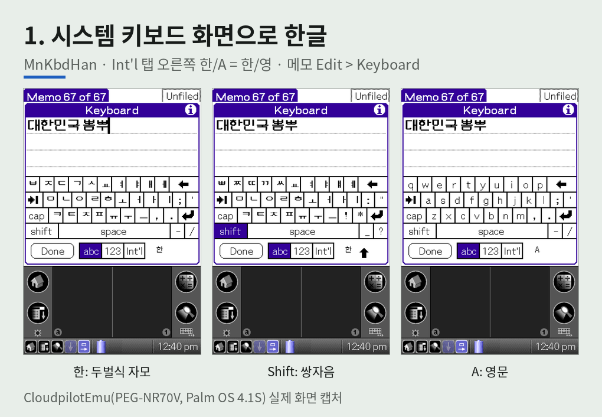
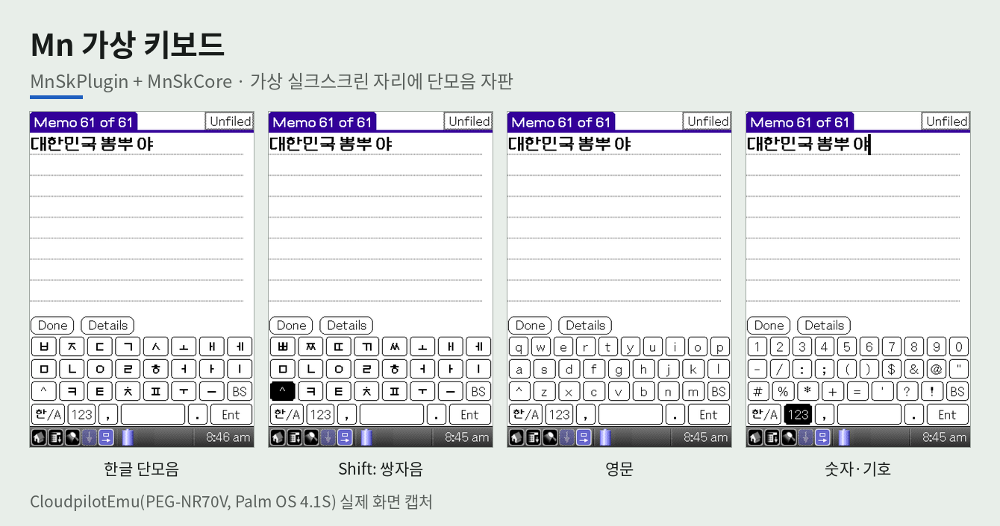
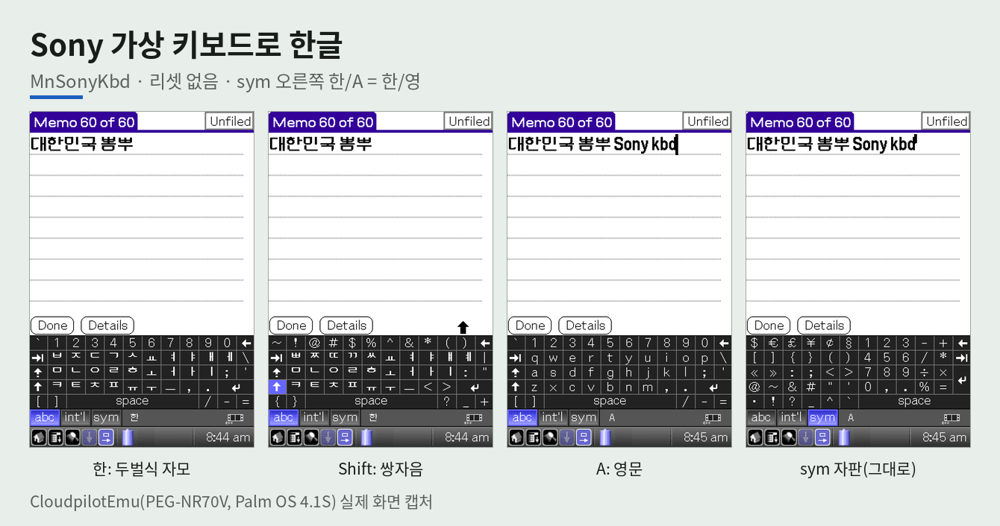
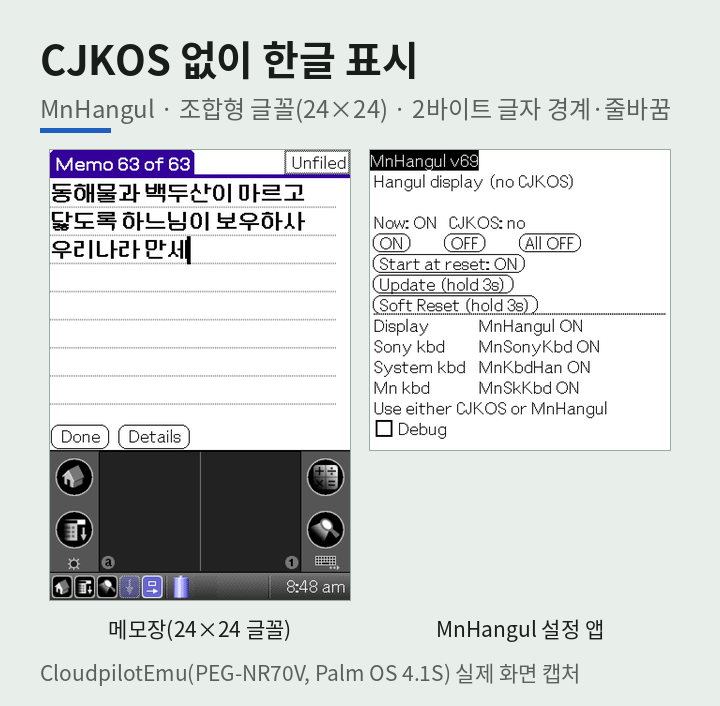
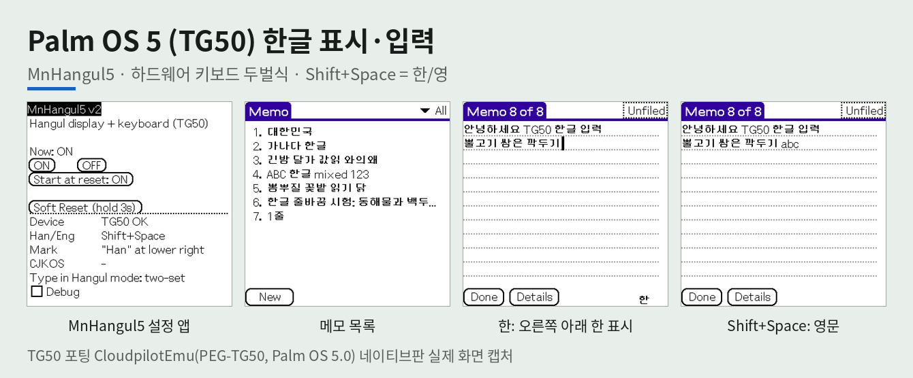
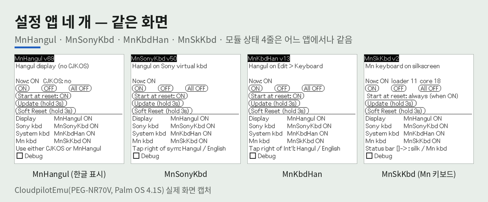

# clie-hangul-keyboard

> **Abstract.** This project adds Korean (Hangul) text entry and display to the Sony CLIÉ PEG-NR70V,
> a Palm OS 4.1S handheld whose English ROM has no Korean support. It consists of three independently
> installable modules. (1) *Mn virtual keyboard* (`MnSkPlugin` + `MnSkCore`) draws a Korean soft keyboard
> in the device's virtual silkscreen area through Sony's undocumented `SkWr` plug-in interface,
> reverse-engineered from the ROM's `SilkExtn` module. (2) *MnSonyKbd* turns Sony's built-in virtual keyboard into a
> two-set (Dubeolsik) Hangul keyboard by intercepting system traps (`BltDrawChars`, `EvtGetEvent`,
> `WinDrawBitmap`): key labels are redrawn as Hangul jamo, a Hangul/English button is drawn next to the
> `sym` tab, and keystrokes are composed into KS X 1001 (EUC-KR) syllables with the PC two-set rule
> (Shift = double consonants). A fourth module, *MnKbdHan*, does the same for the system keyboard dialog
> (also usable on Palm OS 4 devices without a virtual silkscreen); on hi-res devices its jamo key labels are
> pre-built 16×16 bitmaps, which keeps Hangul typing as fast as English. (3) *MnHangul* is an experimental replacement for
> the commercial CJKOS system that renders double-byte Hangul from compact Johab-style glyph packs and
> patches the text-width and character-boundary routines. All runtime code is position-independent and
> installed as RAM trap patches without ROM modification. The patch-based modules need no reset and
> re-attach patches that other system extensions have unhooked; MnSonyKbd also works alongside CJKOS,
> while MnHangul detects CJKOS and stays off. Four settings apps (MnHangul, MnSonyKbd, MnKbdHan, MnSkKbd)
> share one screen layout; MnSkKbd turns the Mn virtual keyboard on or off by switching its plug-in
> database type, effective after a reset.
> *MnHangul5* brings Hangul display and two-set hardware-keyboard input to the Palm OS 5 Sony PEG-TG50
> by replacing entries in the RAM function table of the ARM system (68k trap patching is refused on OS 5);
> it was tested only in a TG50 port of CloudpilotEmu.
> **Test environment.** All development and verification were done in the CloudpilotEmu web emulator
> running a PEG-NR70V (Palm OS 4.1S) ROM image, mainly in Memo Pad, with and without CJKOS installed.
> The screenshots in this README are real emulator captures, taken by driving the emulator
> (`cloudpilot-emu-embedded` in headless Chromium) with scripted pen taps.
> **No testing has been performed on a physical device**, and applications other than Memo Pad remain untested.

Sony CLIÉ PEG-NR70V(Palm OS 4.1S)에서 한글을 쓰기 위한 모듈 모음. 한글 **표시**와 한글 **키보드**를 따로 골라 조합한다.

## 목차

**개요** — [한글 입력 방법](#한글-입력-방법) · [소개](#소개)(화면 그림) · [용어](#용어) · [현재 상태](#현재-상태)

**한글 입력 (키보드 3개)**

| [1. 시스템 키보드 화면](#1-시스템-키보드-화면-한글mnkbdhan) | [2. Mn 가상 키보드](#2-mn-가상-키보드mnskpluginmnskcore) | [3. Sony 가상 키보드](#3-sony-가상-키보드로-한글mnsonykbd) |
| --- | --- | --- |
| `MnKbdHan` | `MnSkPlugin` + `MnSkCore` (+ `MnSkKbd`) | `MnSonyKbd` |
| 화면 안 팝업(Edit > Keyboard), 두벌식 | 화면 밖 실크스크린에 자체 자판, 단모음 | 화면 밖 Sony 자판, 두벌식 |
| Int'l 오른쪽 `한`/`A`, 리셋 없음 | 왼쪽 아래 `한/A` 키, 리셋 1번(등록) | sym 오른쪽 `한`/`A`, 리셋 없음 |

**한글 표시** — [OS 4: MnHangul](#한글-표시mnhangul)(CJKOS 대신) · [OS 5 TG50: MnHangul5](#palm-os-5-tg50-한글mnhangul5)(표시 + 키보드 입력)

**설치·설정** — [설치·업데이트](#설치업데이트)(설치 경우 A~D, 배포 파일) · [설정 앱 공통](#설정-앱-공통-화면켜기업데이트)(네 앱 같은 화면, All OFF·Update)

**참고** — [제한사항](#제한사항) · [문서](#문서) · [시험 환경](#시험-환경) · [빌드 환경](#빌드-환경) · [test/hello.prc](#testhelloprc)

## 한글 입력 방법

키보드가 어디에 뜨는지에 따라 세 가지가 있다.

| 방법 | 키보드 위치 | 앱 화면 | 이 저장소 모듈 | 상태 |
| --- | --- | --- | --- | --- |
| 1. 화면 안 키보드 | 앱 화면 위에 팝업(시스템 키보드 화면, CJKOS 한글 키보드 등) | **가려져 좁아짐** | MnKbdHan(시스템 키보드 화면에 두벌식) | 시험 단계. 가상 실크가 없는 OS 4 영문 기종(T600C 등)용, NR70V에서도 동작 |
| 2. 화면 밖 실크스크린에 자체 키보드 | 가상 실크스크린(Graffiti 자리)에 **이 저장소의 자판**을 그림 | 그대로 | Mn 가상 키보드(`MnSkPlugin` + `MnSkCore`) | 구현. 단모음 한글·영문·숫자 |
| 3. 화면 밖 Sony 키보드를 한글 자판으로 | 가상 실크스크린의 **Sony 가상 키보드**를 그대로 쓰고 키 글자·입력만 두벌식으로 | 그대로 | MnSonyKbd | 시험 단계. sym 오른쪽 `한`/`A` = 한/영, Shift 쌍자음 |

입력한 한글을 화면에 그리는 **한글 표시**는 입력 방법과 별개로 필요하다: OS 4(NR70V 등)는 CJKOS 등 한글 시스템 또는 MnHangul, OS 5(TG50)는 MnHangul5(표시와 하드웨어 키보드 입력을 함께).

## 모듈

| 모듈 | 파일 | 하는 일 | 상태 |
| --- | --- | --- | --- |
| Mn 가상 키보드 | `MnSkPlugin.prc` + `MnSkCore.prc` (+ 설정 앱 `MnSkKbd.prc`) | 가상 실크스크린(Graffiti 영역) 자리에 단모음 한글·영문 QWERTY 자판 | 구현 완료, 동결(안정화). 나랏글은 보류. 켜기/끄기는 `MnSkKbd`(리셋 1번) |
| Sony 가상 키보드 한글 | `MnSonyKbd.prc` | Sony 내장 가상 키보드에 두벌식 한글. sym 탭 오른쪽 `한`/`A` = 한/영, 키 글자를 자모로 표시 | 시험 단계, 리셋 없음 |
| 시스템 키보드 화면 한글 | `MnKbdHan.prc` | 시스템 키보드 화면(메모 Edit > Keyboard)에 두벌식 한글. Int'l 오른쪽 `한`/`A` = 한/영 | 시험 단계, 리셋 없음 |
| 한글 표시(CJKOS 대체) | `MnHangul.prc` | 조합형 글꼴로 2바이트 한글 그리기, 글자 경계, 폭·줄바꿈 | 시험 단계, 리셋 없음 |
| Palm OS 5 한글(TG50) | `MnHangul5.prc` | TG50(Palm OS 5)에서 한글 표시 + 하드웨어 키보드 두벌식 입력(Shift+Space 한/영) | 시험 단계(에뮬레이터만), 리셋 없음 |

OS 4에서는 한글 표시를 CJKOS 등 기존 한글 시스템으로 해도 되고 MnHangul로 해도 된다. 둘을 같이 켜지는 않는다(MnHangul이 CJKOS를 감지하면 켜지지 않음).
OS 5(TG50)는 MnHangul5 하나로 표시와 입력을 한다(OS 4 모듈은 OS 5에서 동작하지 않음).

설정 앱은 넷이고 화면이 같다: `MnHangul`(한글 표시), `MnSonyKbd`(Sony 가상 키보드), `MnKbdHan`(시스템 키보드 화면), `MnSkKbd`(Mn 가상 키보드). 어느 앱에서나 네 모듈의 상태가 보인다([공통 화면](#설정-앱-공통-화면켜기업데이트)). `ClieDiag`는 개발용 진단 전용이다.

## 소개

[한글 입력 방법](#한글-입력-방법)의 분류대로 그림을 나눈다. 그림은 모두 **실제 화면 캡처**이고, OS 4 그림은 CloudpilotEmu(PEG-NR70V, Palm OS 4.1S)다
(MnSonyKbd v47·MnSkCore build 19·MnKbdHan v16·MnHangul v67, 설정 앱 그림은 MnHangul v69·MnSonyKbd v50·MnKbdHan v13·MnSkKbd v2, CJKOS 없이 MnHangul로 한글 표시).
OS 5 그림(MnHangul5 v2)만 TG50 포팅 CloudpilotEmu 네이티브판(PEG-TG50, Palm OS 5.0) 캡처다.
캡처는 에뮬레이터를 브라우저 없이 돌리고 펜 누름(TG50은 키 입력)을 스크립트로 재생해 얻었다. 원본은 `docs/images/capture/`, 그림 다시 만들기: `python3 tools/gen-readme-captures.py`.

### 1. 화면 안 키보드 — MnKbdHan



### 2. 화면 밖 실크스크린에 자체 키보드 — Mn 가상 키보드



### 3. 화면 밖 Sony 키보드를 한글 자판으로 — MnSonyKbd



### 세 키보드 쓰는 법 비교

| | 1. 시스템 키보드 화면 (MnKbdHan) | 2. Mn 가상 키보드 | 3. Sony 가상 키보드 (MnSonyKbd) |
| --- | --- | --- | --- |
| 여는 법 | 메모 등에서 메뉴 Edit > Keyboard | 상태바 □→ 아이콘(누를 때마다 기본 실크 ↔ Mn 키보드) | 상태바 키보드 아이콘 → `abc` 탭 |
| **한/영 전환** | **Int'l 탭 오른쪽 `한`/`A`** 누름 | **왼쪽 아래 `한/A` 키** 누름 | **sym 탭 오른쪽 `한`/`A`** 누름 |
| 한글 자판 | 두벌식(키 글자가 자모로 바뀜) | 단모음(모음 연타 ㅏㅏ→ㅑ, ㅓㅓ→ㅕ, ㅗㅗ→ㅛ, ㅜㅜ→ㅠ, ㅐㅐ→ㅒ, ㅔㅔ→ㅖ) | 두벌식(키 글자가 자모로 바뀜) |
| 쌍자음 | `shift` 누르고 자음(한 글자 뒤 풀림) | `^` 누르고 자음 | Shift 누르고 자음(한 글자 뒤 풀림) |
| 대문자 고정·자동 대문자 | 한글에는 영향 없음(기본 자모) | — | 한글에는 영향 없음(기본 자모) |
| 숫자·기호 | `123`·`Int'l` 탭(그대로) | `123` 키 | `sym`·`int'l` 탭(그대로) |
| 지우기 | ← : 조합 중이면 자모 단위 | `BS` : 조합 중이면 자모 단위 | ← : 조합 중이면 자모 단위 |

### 한글 표시 — OS 4: MnHangul (입력 방법과 별개)



### 한글 표시·입력 — OS 5: MnHangul5 (TG50)



## 용어

| 용어 | 뜻 |
| --- | --- |
| 가상 실크스크린 | NR70V 화면 아래쪽에서 Graffiti 입력 영역과 상태바를 소프트웨어로 그리는 영역 |
| Graffiti | Palm OS의 필기 인식 입력 방식(그 입력 영역) |
| `SilkExtn` | NR70V ROM에 들어 있는 Sony의 실크스크린 제어 확장 모듈 |
| `SkWr` | `SilkExtn`이 부팅 때 찾아 호출하는 플러그인 DB의 타입 식별자 |
| 로더(Loader) | 부팅 때 `SilkExtn`에 등록되어, 키보드 본체에 이벤트를 넘겨주는 작은 프로그램(`MnSkPlugin.prc`) |
| 본체(Core) | 자판 그리기, 터치 판정, 한글 조합을 실제로 처리하는 프로그램(`MnSkCore.prc`) |
| PRC | Palm OS의 앱·코드·리소스를 담아 배포하는 데이터베이스 파일 형식 |
| CJKOS | 영문 Palm OS에서 한중일 문자 표시·입력을 지원하는 외부 소프트웨어 |
| Sony 가상 키보드 | NR70V 상태바 키보드 아이콘으로 여는 ROM에 들어 있는 Sony의 영문 키보드(`SilkExtn`). MnSonyKbd가 키 글자를 자모로 바꿔 그리고 sym 탭 오른쪽에 `한`/`A`를 그린다 |
| 시스템 키보드 화면 | Palm OS가 띄우는 화면 안 키보드(메모 Edit > Keyboard 등, `SysKeyboardDialog`). MnKbdHan이 키 글자를 자모로 바꿔 그린다 |
| Mn 가상 키보드 | 이 저장소의 단모음 한글 키보드(`MnSkPlugin` + `MnSkCore`). 글에서 줄여 Mn 키보드 |
| 연결(패치) | 시스템 함수(트랩) 주소를 자기 코드로 바꿔 끼우는 것. 여러 모듈이 같은 함수에 차례로 끼면 위에서 아래로 이어 부른다 |

## 현재 상태

현재 판 번호는 각 앱 화면 제목과 [KOREAN_SUPPORT.md](docs/KOREAN_SUPPORT.md)에서 확인한다. 아래 표의 판 번호는 그 기능이 들어온 판이다.

| 기능 | 상태 |
| --- | --- |
| Mn 가상 키보드: 가상 실크스크린 자리에 자판 표시(고해상도 320×130) | 구현 완료 (런처·메모장·ClieDiag에서 실측) |
| Mn 가상 키보드: 영문 QWERTY, 숫자·특수문자 | 구현 완료 |
| Mn 가상 키보드: 한글 단모음 (Shift 쌍자음, 모음 연타 ㅑㅕㅛㅠㅒㅖ) | 구현 완료, 안정화 단계. build 19부터 자모 키 이름을 다른 키보드와 같은 Neo둥근모 낱자모로 그림(자동 입력 시험 9개 통과) |
| 한글 조합: 초성·중성·종성, 복합모음, 겹받침, 받침 넘김, 조합 중 자모 단위 BS | 구현 완료 (메모장 실측, PC 조합 시험 41개 통과) |
| Mn 가상 키보드: 리셋 없는 본체(`MnSkCore`) 업데이트 / 리셋 1번 로더(`MnSkPlugin`) 업데이트 | 구현 완료 (CloudpilotEmu 실측) |
| Mn 가상 키보드: 나랏글 / 키 반복 | 개발 보류 / 미구현 |
| Sony 가상 키보드 한글(MnSonyKbd, MnHangul v35에서 시작해 v54에 분리): 키 글자 두벌식 자모, 조합 입력 | 시험 단계. CloudpilotEmu 메모장에서 CJKOS와 같이(B)·MnHangul과 같이(D) 실측 |
| MnSonyKbd: 한/영을 ⇪에서 sym 오른쪽 `한`/`A` 단추로(누르면 자판 바로 바뀜), PC 두벌식 규칙(Shift = 쌍자음, ⇪·자동 대문자 = 기본 자모) | v32~v49 (CloudpilotEmu 실측. v49 자동 시험: Sony 입력 9개·자판 표시 모두 통과 — 0~0.3초 간격, Shift, 조합 중 BS, 한/A 섞어 쓰기, 겹받침. MnSonyKbd를 켠 채 Mn 가상 키보드 9개도 통과) |
| 시스템 키보드 화면 한글(MnKbdHan): 키 글자 자모, 두벌식 조합 입력(Shift = 쌍자음, 키보드 화면이 스스로 건 대문자는 기본 자모), Int'l 오른쪽 `한`/`A`(NR70V는 Sony 키보드와 같은 그림) | v12~. v13부터 `Start at reset`(리셋 뒤 자동 시작)·`Update`. v16부터 NR70V는 키 글자 자모를 그림으로 그려 한 모드가 영문만큼 빠름(전에는 빨리 치면 밀려 키가 빠짐). T600C·NR70V 메모장 실측, 자동 시험 9개·속도별 4개 통과(v15까지는 빨리 치면 화면 반영이 늦고 키가 빠질 수 있었음 — v16에서 개선, 초당 약 6회까지 시험 정상) |
| 키 큐 넣기·빠른 입력 점검(MnSonyKbd v51·MnKbdHan v14~v15 진단) | 자동 시험에서 `EvtEnqueueKey` 실패 0(Sony 719번·MnKbdHan 443번, 간격 0 포함). Sony 키보드는 0.04초 간격 96키 정상. MnKbdHan 키 빠짐은 키 글자를 MnHangul로 그리는 비용 때문이었고 v16에서 개선. 사람이 칠 수 없는 속도(초당 약 12~33회)에서는 아직 몇 자모 빠짐 |
| MnSonyKbd: CJKOS를 켜거나 끈 뒤 빠진 연결 자동 복구 | 시험 단계. 키 글자 v3~, 입력 v9~ (CloudpilotEmu 실측) |
| 조합 중 커서 이동 감지 | Mn 가상 키보드 build 17~, MnSonyKbd v10~ (메모장 실측) |
| 리셋 없는 업데이트 `All OFF`(세 모듈 순서대로 끄기) | MnHangul v64~·MnSonyKbd v14~, 세 모듈은 MnHangul v69·MnSonyKbd v50·MnKbdHan v13·MnSkKbd v2 (CloudpilotEmu 실측) |
| 네 설정 앱 같은 화면(Now·ON/OFF/All OFF·Start at reset·Update·Soft Reset·모듈 상태 4줄·Debug) | MnHangul v69·MnSonyKbd v50·MnKbdHan v13·MnSkKbd v2 (CloudpilotEmu 자동 시험) |
| Mn 가상 키보드 켜기/끄기(`MnSkKbd`: 로더 DB 타입 바꾸기 + 리셋, 끄면 □→ 없어짐) | MnSkKbd v1 진단·v2 (CloudpilotEmu 실측) |
| 런처 지우기 때 자동 끄기(위에 다른 패치가 있으면 거부) | MnHangul v66~ (CloudpilotEmu 실측), MnSonyKbd v18~ (시험 중). MnKbdHan은 없음(`OFF` 뒤 지우기). 업데이트 설치는 에뮬레이터가 알림 없이 거부하므로 `All OFF` 그대로 |
| 한글 표시(MnHangul): 조합형 글꼴(12·16·24, 24는 추가 글꼴), 글자 경계(글자 단위 BS·커서), 폭·줄바꿈 | 시험 단계. CJKOS 없이 메모장 실측. 리셋 없이 `ON`, 리셋 뒤 자동 시작 |
| MnHangul: 다른 기종 — T600C(영문 Palm OS 4.1)에서 표시·글자 단위 BS·줄바꿈 정상. N710C(영문 Palm OS 4.1, 고해상도)에서 MnHangul v69 + MnKbdHan v16 입력 시험 9개·0.1초 간격 48키 통과. 입력은 MnKbdHan(시스템 키보드 화면 두벌식, 진단 판 v9)으로 조합 입력 확인. OS 3.5·일본어(Shift-JIS) 기종은 켜지 않음(v68) | CloudpilotEmu 실측 |
| MnHangul: CJKOS 감지(켜져 있으면 `ON`·자동 시작 안 함) | 시험 단계 (v56, v61부터 CJKOS 자신의 Feature `dCJK`로 판정, v62에서 예전 방식 뺌) |
| Palm OS 5(TG50) 한글(MnHangul5 v1~): 표시(목록·본문·줄바꿈·`…` 자르기·글자 단위 BS), 키보드 두벌식(Shift 쌍자음, 자모 단위 BS), Shift+Space 한/영, 입력칸 오른쪽 아래 `한` 표시, 리셋 뒤 자동 시작. v2부터 한글을 글자마다 그림 한 번으로 그려 영문과 비슷한 속도(v1 대비 약 8배) | 시험 단계. TG50 포팅 CloudpilotEmu 네이티브판 메모장 실측(0.06초 간격 입력 포함). 실기 미시험 |

## 1. 시스템 키보드 화면 한글(MnKbdHan)

메모 등에서 메뉴 Edit > Keyboard로 여는 시스템 키보드 화면(`SysKeyboardDialog`)에 두벌식 한글을 넣는다. `MnKbdHan.prc` 하나, 리셋 없음.
Sony 가상 실크가 없는 OS 4 영문 기종(T600C 등)용으로 만들었고 NR70V에서도 동작한다. 한글 표시는 하지 않으므로 CJKOS 등이나 MnHangul과 같이 쓴다.


**쓰는 법**

| 동작 | 결과 |
| --- | --- |
| Edit > Keyboard | 키보드 화면. Int'l 탭 오른쪽에 `한` 또는 `A`가 보인다(닫았다 열어도 유지) |
| `한`/`A` 누름 | 한/영 전환. 키 글자가 바로 두벌식 자모 ↔ 영문으로 바뀌고, 조합 중이던 글자는 확정된다 |
| 한글에서 `shift` | 쌍자음 ㅃㅉㄸㄲㅆ, ㅒㅖ (한 글자 넣으면 풀림). 키보드 화면이 스스로 건 대문자(빈 입력칸 첫 글자)·`cap`은 기본 자모 |
| ← | 조합 중이면 자모 단위로 지움 |
| `123`·`Int'l` 탭 | 그대로 쓴다 |
| `Done` | 키보드 화면의 글이 앱 입력칸으로 간다 |

**첫 화면**: `ON` / `OFF` = 키보드 화면 한글 켬 / 끔. 나머지는 [공통 화면](#설정-앱-공통-화면켜기업데이트)과 같고, `[ ] Debug` = 진단 화면(키 큐 넣기 수·실패, 이벤트 처리 시간, 키 글자를 영문으로 그리는 시험 스위치).

**제한**

- 키보드 화면은 키를 누를 때·뗄 때마다 키 글자 26개를 다시 그린다. v16부터 NR70V(Sony HR 라이브러리가 있는 기종)는 한글 키 글자를 미리 만든 16×16 자모 그림(MnSonyKbd·Mn 키보드와 같은 데이터)으로 그려 한글 입력이 영문만큼 빠르다(펜 이벤트 처리 11.8 → 5.7틱, 초당 약 6회 48키 정상). HR 라이브러리가 없는 기종(T600C 등)은 예전처럼 한글 표시 모듈이 그리는 글자라 빨리 치면 늦게 반영되거나 키가 빠질 수 있다(v16 T600C는 미시험).
- 키 자리·한/A 자리는 영문 키보드 화면 배치(T600C·NR70V 실측)에 맞춘 고정 좌표다. 다른 배치(일본어 등)에서는 켜지 않는다(OS 4 이상 + 문자 인코딩 PalmLatin일 때만).
- 켜진 채로는 런처에서 지울 수 없다(보호). `OFF` 뒤 지운다(코드 기준, 미시험).
- 메모장에서만 시험했다.

## 2. Mn 가상 키보드(MnSkPlugin·MnSkCore)

가상 실크스크린(Graffiti 자리)에 이 저장소의 단모음 한글·영문 자판을 그린다(설치 A·C). 로더 `MnSkPlugin.prc` + 본체 `MnSkCore.prc`, 처음 설치 때 리셋 1번.
설정 앱 `MnSkKbd.prc`(선택)로 켜고 끄고 상태를 본다. 한글 표시는 하지 않으므로 CJKOS 등(A)이나 MnHangul(C)과 같이 쓴다.


**쓰는 법**

| 동작 | 결과 |
| --- | --- |
| 상태바 □→ | 누를 때마다 기본 실크 ↔ Mn 키보드. □→는 상태바 5번째 아이콘으로, Mn 키보드가 등록되어 있을 때만 보인다 |
| 왼쪽 아래 `한/A` 키 | 한/영 전환 |
| 한글 자판 | 단모음. 모음 연타 ㅏㅏ→ㅑ, ㅓㅓ→ㅕ, ㅗㅗ→ㅛ, ㅜㅜ→ㅠ, ㅐㅐ→ㅒ, ㅔㅔ→ㅖ |
| `^` 누르고 자음 | 쌍자음 |
| `BS` | 조합 중이면 자모 단위로 지움 |
| `123` 키 | 숫자·기호 |

**첫 화면(MnSkKbd)**

| 버튼·표시 | 뜻 |
| --- | --- |
| `Now: ON  loader N  core N` | Mn 키보드 등록 상태(ON / off / `ON after reset` / `off after reset` / `not installed`), 로더·본체 빌드(본체는 한 번 켠 뒤 보임) |
| `ON` / `OFF` | 로더 DB 타입을 `SkWr` / `SkWo`로 바꿈. **리셋 뒤 적용**(`Soft Reset`). 끄면 상태바 □→가 없어지고 Graffiti 판만 남는다(MnSkKbd v1 실측) |
| `Start at reset` | 해당 없음 — 켜져 있으면 부팅 때 늘 등록된다 |
| 나머지 | [공통 화면](#설정-앱-공통-화면켜기업데이트)과 같음. `All OFF`는 다른 세 패치 모듈만 끈다(Mn 키보드는 끄려면 리셋이 필요해 넣지 않음) |

Mn 키보드는 다른 셋과 달리 시스템 함수를 바꿔 끼우지 않고 `SilkExtn`이 부팅 때 플러그인 DB를 찾아 등록한다. 그래서 켜기/끄기와 로더 업데이트에 리셋이 필요하다.

**업데이트·켜기/끄기**

| 작업 | 절차 | 리셋 |
| --- | --- | --- |
| Mn 키보드 본체(`MnSkCore.prc`) 업데이트 | □→로 끄기 → `MnSkCore.prc` 설치 → □→로 켜기 | 없음 |
| Mn 키보드 로더(`MnSkPlugin.prc`) 업데이트 | □→로 끄기 → `MnSkPlugin.prc` 설치 → 바로 리셋 | 1번 |
| (MnSkKbd가 있을 때) 로더·본체 함께 | MnSkKbd `Update (hold 3s)`(Mn 키보드 끄고 다른 모듈도 한 번 건너뛰며 리셋) → 설치 → MnSkKbd `ON` → `Soft Reset` | 2번 |
| Mn 키보드 끄기 / 켜기 | MnSkKbd `OFF` / `ON` → `Soft Reset` | 1번 |

- 리셋 방법(아무것이나): 네 설정 앱의 `Soft Reset (hold 3s)`, CloudpilotEmu의 Reset 메뉴(Soft reset), 실기기는 뒷면 리셋 구멍.
- **로더는 고정한다.** 로더와 본체 사이 약속(ABI 1: 본체 찾는 방법, 이벤트 넘기는 방식, 기록 번호)은 바꾸지 않고 새 기능은 본체에만 넣는다.
  그래서 업데이트는 보통 본체만이고 리셋이 필요 없다. 로더는 로더 자체 버그나 약속으로 넘길 수 없는 정보가 필요할 때만 바꾸며,
  그때는 릴리스 안내에 "로더 변경 — 리셋 1번"을 적는다. 사용자가 겪는 리셋은 처음 설치 1번이 된다.

**리셋이 필요한 이유와 필요 없는 이유** (Mn 가상 키보드. MnHangul·MnSonyKbd·MnKbdHan은 시스템 함수를 켜는 즉시 바꿔 끼우므로 리셋이 필요 없다)

| 작업 | 이유 |
| --- | --- |
| 처음 설치 → 리셋 | **가상 실크스크린에 키보드 등록.** `SilkExtn`은 **부팅할 때만** `SkWr` 플러그인 DB를 찾아 등록한다. 설치만 해서는 로더가 등록되지 않아 □→ 아이콘이 생기지 않는다. ROM 분석 결과 부팅 말고 다시 찾게 하는 경로(알림·HotSync 등)는 없다([개발 이력](docs/DEVELOPMENT_HISTORY.md#nr70v-skwr-플러그인-역분석-및-시험-기록-초기-가설실측-구분)). |
| Mn 키보드 로더(`MnSkPlugin.prc`) 업데이트 → 리셋 | `SilkExtn`은 부팅 때 등록한 **옛 로더 코드 주소**로 계속 호출한다. 리셋해야 새 로더가 등록된다. 리셋 전에 □→로 켜면 지워진 옛 코드로 호출되어 멈출 수 있다. |
| Mn 키보드 본체(`MnSkCore.prc`) 업데이트 → 리셋 없음 | 본체는 로더가 키보드를 켤 때(Start)마다 DB에서 불러와 잠그고, 끌 때(Stop) 잠금을 푼다. 그래서 끈 상태에서 바꿔 넣으면 다음에 켤 때 새 본체를 불러온다. |
| 본체(`MnSkCore.prc`) 업데이트 전 □→로 끄기 | 켜 둔 채 설치하면 로더가 잠가 둔 옛 본체가 지워진다. 이후 끄거나 켤 때 `MemoryMgr.c … Chunk under-locked` 오류로 멈출 수 있다(리셋하면 복구). |

- 확인: MnSkKbd `Now: ON  loader N  core N`(본체는 한 번 켠 뒤 보임). 자세히는 ClieDiag 첫 화면 `loader: build N`, `protect: released`, `core: build N`, `load: ok`.
- 로더 리셋 1번 업데이트는 CloudpilotEmu에서 실측 성공했다. 단, **설치 후 리셋 전에 □→로 키보드를 켜지 않는다**(실크 확장이 옛 로더 코드 주소를 쓰므로 멈출 수 있음).
  이상이 생겨도 자동 복구는 보장하지 않으므로 시험 전에 에뮬레이터 세션을 백업한다. 자세한 내용: [docs/RECOVERY.md](docs/RECOVERY.md).

**제한**

- NR70V ROM `SilkExtn`의 비공개 `SkWr` 플러그인 방식(ROM 역분석)에 기댄다. 가상 실크가 없는 기종에서는 동작하지 않는다.
- 나랏글은 개발 보류, 키 반복은 미구현.
- 조합 중 커서 이동은 [제한사항](#제한사항) 참고.
- 지우기: MnSkKbd `OFF` → `Soft Reset` 뒤 지우기 권장(미시험).
- 런처·메모장·ClieDiag에서 시험했다.

## 3. Sony 가상 키보드로 한글(MnSonyKbd)

Mn 키보드 없이, NR70V에 들어 있는 Sony 가상 키보드로 두벌식 한글을 넣는다(설치 B·D). `MnSonyKbd.prc` 하나, 리셋 없음.
한글 표시는 하지 않으므로 CJKOS 등 한글 시스템(B)이나 MnHangul(D)과 같이 쓴다(첫 화면 모듈 상태의 `Display` 줄에 CJKOS / MnHangul / none 표시). v54에 MnHangul에서 분리했다.


**쓰는 법** (PC 두벌식과 같은 규칙)

| 동작 | 결과 |
| --- | --- |
| 상태바 키보드 아이콘 → `abc` 자판 | Sony 가상 키보드. sym 탭 오른쪽에 `한` 또는 `A`가 보인다 |
| `한`/`A` 누름 | 한/영 전환. 자판 글자가 바로 두벌식 자모 ↔ 영문으로 바뀌고, 조합 중이던 글자는 확정된다 |
| 한글에서 그냥 누름 | 기본 자모(ㅂㅈㄷㄱㅅ, ㅐㅔ) |
| 한글에서 Shift | 쌍자음 ㅃㅉㄸㄲㅆ, ㅒㅖ (한 글자 넣으면 풀림) |
| ⇪·자동 대문자 | 한글에는 영향 없음(기본 자모). ⇪는 영문 대문자 고정으로만 쓴다 |
| ← (BS) | 조합 중이면 자모 단위로 지움 |
| `sym`·`int'l` 자판 | 그대로 쓴다. 이때 `한`/`A`를 누르면 표시만 바뀌고, `abc`로 돌아오면 그 상태로 그려진다 |

**MnSonyKbd 첫 화면**

| 버튼 | 뜻 |
| --- | --- |
| `ON` / `OFF` | Sony 가상 키보드 한글(입력·`한`/`A` 단추·키 글자 자모)을 켬 / 끔 |
| 나머지 | [공통 화면](#설정-앱-공통-화면켜기업데이트)과 같음. `[ ] Debug`(또는 제목 누르기) = 진단 기록 화면(자판 다시 그리기·shift 판단·조합 끝 까닭 등) |

`Now:` 줄은 실제 연결 상태다: `ON`(연결됨) / `ON (other patch above)`(위에 다른 패치가 있어 끝까지 확인 못 함) / `broken: tap ON`(빠짐, `ON`을 누르면 다시 이음) / `off`.
`ON`을 눌렀을 때 `already ON`은 이미 켜져 있고 연결도 정상이라 할 일이 없다는 뜻이다.


**제한**

- NR70V ROM의 Sony 가상 키보드(`SilkExtn`) 전용이다. Sony는 `한`/`A` 단추를 모르므로, 누를 때 MnSonyKbd가 Sony가 그린 영문 키 자리를 기억해 두었다가 직접 다시 그린다(Sony 글꼴·화면 색을 읽어 같은 모양으로).
- Shift는 Sony가 그리는 첫 줄 글자(`` ` ``/`~`)와 마지막으로 누른 키(shift 키인지)로 판단한다. 키보드를 열 때 자동으로 걸린 대문자는 기본 자모로 본다.
- Sony 자판이 떠 있을 때만 동작한다(v49). Mn 가상 키보드·시스템 키보드 화면·Graffiti 입력에는 끼어들지 않는다(자동 시험으로 확인).
- 한글 범위는 완성형 2,350자(Mn 키보드와 같음).
- 메모장에서만 시험했다. 다른 앱과 실기기는 검증 대상이다.

## 한글 표시(MnHangul)

CJKOS 없이 한글을 표시한다(설치 C·D). CJKOS를 끈 백업 세션에서만 시험한다.


| 버튼·표시 | 뜻 |
| --- | --- |
| `Now: ON/off   CJKOS: running/no` | 한글 표시 연결 상태, CJKOS 감지 |
| `ON` / `OFF` | 한글 표시를 켬 / 끔(v68까지 `Hangul ON`/`Hangul OFF`). 이미 켜져 있으면 다시 끼우지 않는다(v58). CJKOS가 감지되면 켜지지 않는다 |
| 나머지 | [공통 화면](#설정-앱-공통-화면켜기업데이트)과 같음. `[ ] Debug` = 개발용 진단 화면 |

## Palm OS 5 (TG50) 한글(MnHangul5)

Sony PEG-TG50(Palm OS 5.0 영문)용. 한글 표시와 하드웨어 키보드 입력을 한 모듈이 한다. OS 4 모듈(MnHangul·키보드 셋)은 OS 5에서 동작하지 않는다
(입력칸 처리가 ARM 안에서 끝나 68k 트랩을 거치지 않고, 68k 트랩 바꾸기는 OS 5가 거부한다 — [docs/OS5_RESEARCH.md](docs/OS5_RESEARCH.md)).


| 항목 | 내용 |
| --- | --- |
| 설치 | `MnHangul5.prc` 설치 → 앱에서 `ON`. 리셋 필요 없음 |
| 한/영 | **Shift+Space**. 한글 모드면 입력칸 화면 오른쪽 아래(Shift 화살표 자리)에 `한` |
| 자판 | 두벌식(PC와 같음). Shift + `q w e r t` = ㅃ ㅉ ㄸ ㄲ ㅆ, Shift + `o p` = ㅒ ㅖ. 조합 중 BS = 자모 하나 |
| 표시 | 완성형(KS X 1001, EUC-KR) 2바이트 한글을 조합형 글꼴(Neo둥근모 16×16 기반)로 그림. 한글 한 칸 = 영문 좁은 글자 폭 둘 정도(표준 좌표 9) |
| 리셋 | `Start at reset: ON`(기본)이면 리셋이 끝난 뒤 자동으로 켜짐 |
| 끄기 | `OFF`. 리셋 뒤에는 Sony 모듈이 그리기 함수 위에 올라오므로 그때는 "쉬기"(코드는 남고 원래 함수로 넘김, 다음 리셋에 빠짐 — `Now: off (idle until reset)`) |
| 기기 확인 | Sony TG50이 아니거나, 바꿀 시스템 함수 칸이 알려진 값이 아니면(다른 패치가 먼저 바꿈 등) 켜지지 않는다(`not supported`, `system table differs`) |
| 업데이트 | 코드는 메모리에 복사해 돌므로 켜진 채로 덮어 설치해도 된다. 새 판은 `OFF` → `ON`(쉬는 중이면 리셋 뒤) |

제한사항: 실기 미시험(실기에서는 복사한 ARM 코드 실행 전에 캐시 처리가 필요할 수 있음), 16×16 글꼴 크기만(큰 글꼴에서도 한글 칸은 같은 크기),
Graffiti 입력은 영문 그대로, 조합 상태는 앱별로 나뉘지 않음(앱 화면을 누르면 조합 끝), TG50 전용(다른 OS5 기종은 칸 번호가 다를 수 있음).

## 설치·업데이트

키보드는 한글을 완성형(KS X 1001, EUC-KR) 2바이트로 넣기만 한다. 화면 표시는 한글 시스템이 맡으므로, 무엇과 같이 쓰는지에 따라 처음 설치가 다르다.

| | A. CJKOS 등 + Mn 가상 키보드 | B. CJKOS 등 + Sony 가상 키보드 | C. MnHangul + Mn 가상 키보드 | D. MnHangul + Sony 가상 키보드 |
| --- | --- | --- | --- | --- |
| 설치 | `MnSkPlugin`, `MnSkCore` (+ 설정 `MnSkKbd`) | `MnSonyKbd` | `MnSkPlugin`, `MnSkCore`, `MnHangul` (+ `MnSkKbd`, 24 글꼴 `MnHgFont24` 선택) | `MnHangul`, `MnSonyKbd` (+ 24 글꼴 선택) |
| 자판 | 단모음 | 두벌식 (sym 오른쪽 `한`/`A` = 한/영) | 단모음 | 두벌식 (sym 오른쪽 `한`/`A` = 한/영) |
| 한글 표시 | 설치된 한글 시스템 (완성형 KS X 1001 2바이트를 표시하는 것) | 설치된 한글 시스템 | MnHangul (시험 단계) | MnHangul (시험 단계) |
| 순서 | 설치 → 리셋 → □→로 켜기 | 설치 → MnSonyKbd `ON` | 설치 → MnHangul `ON` → 리셋 → □→로 켜기 | 설치 → MnHangul `ON` → MnSonyKbd `ON` |
| 리셋 | 처음 1번 — 가상 실크스크린에 Mn 키보드(로더) 등록 (`SilkExtn`이 부팅 때만 찾음) | **없음** — Sony 가상 키보드는 이미 등록되어 있고, MnSonyKbd는 켜는 즉시 동작 | 처음 1번 — Mn 키보드 등록. MnHangul은 리셋 필요 없음 (`Start at reset`으로 리셋 뒤 자동 시작) | **없음** |
| 주의 | MnHangul은 켜지 않음 (같은 함수를 바꾸므로 충돌. MnHangul이 감지해 막는다) | MnHangul은 켜지 않음 | CJKOS 등 다른 한글 시스템은 끈 상태로 | CJKOS 등 다른 한글 시스템은 끈 상태로 |
| 시험 환경 | CloudpilotEmu(NR70V ROM) + CJKOS. 다른 한글 시스템과 실기기는 미시험 | CloudpilotEmu + CJKOS 메모장(MnSonyKbd v2~). 실기기 미시험 | CloudpilotEmu(NR70V ROM). 실기기는 미시험 | CloudpilotEmu 메모장(MnHangul v57~ + MnSonyKbd v5~). 실기기 미시험 |

**배포 파일** (`bin/`)

| 파일 | 필요한 경우 | 역할 |
| --- | --- | --- |
| `MnSkPlugin.prc` | A·C (Mn 가상 키보드를 쓸 때) | 로더. `SilkExtn`에 등록되는 `SkWr` 플러그인(약 1KB)으로, 부팅 때 호출되어 키보드 본체와 연결한다 |
| `MnSkCore.prc` | A·C (Mn 가상 키보드를 쓸 때) | 키보드 본체(자판 그리기·터치 판정·한글 조합). 로더가 불러 실행한다 |
| `MnSonyKbd.prc` | B·D (Sony 가상 키보드로 입력할 때) | Sony 가상 키보드 한글(시험 단계). sym 오른쪽 `한`/`A` 한/영, 두벌식 입력, 키 글자 자모 표시. 한글 표시는 하지 않는다 |
| `MnKbdHan.prc` | 선택 (시스템 키보드 화면으로 입력할 때) | 시스템 키보드 화면 두벌식. `ON`을 누르면 켜짐, 리셋 없음, 리셋 뒤 자동 시작(v13). 한글 표시는 하지 않는다(한글 시스템이나 MnHangul 필요) |
| `MnSkKbd.prc` | A·C 중 선택 (Mn 가상 키보드 설정) | Mn 가상 키보드 켜기/끄기(리셋 1번)·상태·업데이트. 없어도 Mn 키보드는 동작한다(설치하면 켜진 상태) |
| `MnHangul.prc` | C·D (한글 표시를 MnHangul로 할 때) | 한글 표시 모듈(시험 단계). 한글 시스템(CJKOS 등)이 없을 때 한글 표시 |
| `MnHgFont24.prc` | C·D 중 선택 (MnHangul 큰 글꼴) | MnHangul 24×24 추가 글꼴(큰 글꼴용) |
| `MnHangul5.prc` | TG50(Palm OS 5) | 한글 표시 + 하드웨어 키보드 두벌식 입력, 설정 앱 겸용([Palm OS 5](#palm-os-5-tg50-한글mnhangul5)). OS 4 기종에는 설치하지 않는다 |
| `KbdScan.prc` | 개발용 | 다른 기종(N700C·T600C 등) 화면 키보드 진단(v2). 키보드 동작에는 필요 없다 |
| `ClieDiag.prc` | 개발용 | 진단 전용(v29): 로더·본체 기록, SkWr·SkEv 페이지, 복구 스위치(DisS), Feature·트랩 목록, Events 페이지(입력칸 FLD로 키·그래피티 입력 경로 기록). 사용자 설정은 `MnSkKbd`. 키보드 동작에는 필요 없다 |

`MnSkKbd`·`ClieDiag`·`KbdScan`은 선택이다. 네 설정 앱의 화면과 켜기·업데이트는 [공통](#설정-앱-공통-화면켜기업데이트) 절에 있다.

Mn 가상 키보드의 업데이트·켜기/끄기와 리셋이 필요한 이유는 [2. Mn 가상 키보드](#2-mn-가상-키보드mnskpluginmnskcore) 절에 있다.

## 설정 앱 공통: 화면·켜기·업데이트

네 설정 앱(MnHangul v69~·MnSonyKbd v50~·MnKbdHan v13~·MnSkKbd v2~)은 같은 줄·같은 자리에 같은 버튼이 있다(`src/common/app_ui.h`).



| 줄 | 내용 |
| --- | --- |
| 제목 아래 | 한 줄 설명, 알림(누른 결과) |
| `Now:` | 지금 상태 |
| `ON` `OFF` `All OFF` | 이 모듈 켬 / 끔, 세 패치 모듈(MnHangul·MnSonyKbd·MnKbdHan) 모두 순서대로 끔(설치 전) |
| `Start at reset: ON/off` | 리셋 뒤 자동으로 켬(기본 ON). MnSkKbd는 해당 없음(켜져 있으면 부팅 때 늘 등록) |
| `Update (hold 3s)` | 업데이트용 리셋: 설치된 패치 모듈 모두 다음 리셋 한 번 자동 시작을 건너뛴다. MnSkKbd는 Mn 키보드도 끔(설치 뒤 `ON` + `Soft Reset`) |
| `Soft Reset (hold 3s)` | 3초 누르면 소프트 리셋 |
| 모듈 상태 4줄 | `Display`(MnHangul 또는 CJKOS) / `Sony kbd`(MnSonyKbd) / `System kbd`(MnKbdHan) / `Mn kbd`(MnSkKbd) — ON / off / none(설치 안 됨) / `ON after reset`·`off after reset` |
| 사용법 한 줄, `[ ] Debug` | 앱별 사용법, 개발용 진단 화면 |

Mn 가상 키보드(MnSkKbd)의 `ON`/`OFF`는 리셋 뒤 적용되고 `All OFF`에 들어가지 않는다([2. Mn 가상 키보드](#2-mn-가상-키보드mnskpluginmnskcore)).

| 작업 | 절차 | 리셋 |
| --- | --- | --- |
| 처음 설치 | 설치 → 각 앱 `ON` | 없음 (Mn 키보드는 처음 1번) |
| 업데이트 | 아무 앱에서나 `All OFF` → `all off: ready to install`이면 필요한 PRC 설치 → 각 앱 `ON` | 없음 |
| 업데이트(`All OFF`가 `kept`일 때) | 아무 앱에서나 `Update (hold 3s)` → 설치 → 각 앱 `ON` | 1번 (`Update`가 함) |
| 지우기 | 런처 Delete — 켜져 있어도 스스로 끄고 지워짐(MnHangul v66~, MnSonyKbd v18~). MnHangul을 지우면 **24 글꼴 `MnHgFont24`도 함께 지워진다**(크리에이터가 같음). 다른 모듈이 위에 있으면 거부(`Unable to delete`), 그 앱을 열면 `can't delete: <위에 있는 것> on top`(MnHangul v67·MnSonyKbd v19) → 그것을 먼저 지우거나 `All OFF` 뒤 지우기. MnKbdHan은 스스로 끄지 않으므로 켜진 채로는 지울 수 없다 → `OFF` 뒤 지우기. Mn 키보드(`MnSkPlugin`·`MnSkCore`)는 MnSkKbd `OFF` → `Soft Reset` 뒤 지우기 권장(MnKbdHan·Mn 키보드 지우기는 코드 기준, 미시험) | 없음 |
| 리셋 뒤 자동 시작 | 각 앱 `Start at reset: ON`(기본) | — |
| 비상 탈출 | 위 버튼을 누른 채 리셋(CloudpilotEmu: Reset → No extensions). 리셋 알림이 오지 않아 아무것도 켜지 않는다. 이 리셋은 Sony 가상 실크·상태 표시줄도 불러오지 않으므로 끝나면 일반 리셋을 한 번 한다 | — |

- **업데이트에 `Update`를 쓰는 이유**: 켜져 있는 동안은 시스템 함수가 앱 코드를 가리키므로 코드를 잠가 두고, 잠긴 PRC는 덮어쓸 수 없다. `Update`는 다음 리셋 한 번만 자동 시작을 건너뛰게 하고 리셋하므로, 리셋 뒤에는 잠금 없이 설치된다. 설치된 패치 모듈은 어느 앱의 `Update`든 모두 건너뛴다(v57·v5, MnKbdHan은 v13~).
- **리셋 없는 업데이트 `All OFF`**(MnHangul v64·MnSonyKbd v14): 같은 함수에 차례로 끼면 나중에 켠 쪽이 위에 있고, 아래쪽은 위가 먼저 빠지기 전에는 풀지 않는다(`kept`). `All OFF`는 "자기 끄기 → 다른 모듈 끄기"를 최대 세 바퀴 돌려 켠 순서와 상관없이 셋 다 끈다(다른 모듈은 그 앱을 불러 직접 끄게 함). CJKOS가 위에 있으면 `kept: turn CJKOS off, retry` — CJKOS를 끄고 다시 누르거나 `Update`.
- **패치는 RAM의 트랩 표에 걸리므로 어떤 리셋이든 풀린다.** 리셋 뒤 켜져 있는 것은 `Start at reset`이 다시 켰기 때문이다.
- **CJKOS ↔ MnHangul 전환**: CJKOS가 켜져 있으면 MnHangul은 켜지지 않는다. CJKOS를 끈 뒤 MnHangul `ON`. MnSonyKbd는 CJKOS·MnHangul 어느 쪽과도 같이 쓴다.
  MnHangul이 켜진 뒤에 CJKOS를 켜는 것은 막지 못하지만, 이때는 나중에 켠 CJKOS가 한글을 직접 그리고 MnHangul은 한글에 관여하지 않는다(실측, 한글은 CJKOS 글꼴). CJKOS를 끄면 MnHangul로 돌아온다. 헷갈리지 않도록 CJKOS를 켜기 전에 MnHangul `OFF`, CJKOS를 계속 쓸 때는 MnHangul `Start at reset: off`를 **권장**한다.
- **CJKOS를 켜거나 끄면** CJKOS가 시스템 함수를 자기가 저장한 값으로 되돌리면서 MnSonyKbd·MnHangul 연결이 빠질 수 있다. MnSonyKbd는 가상 실크를 누를 때 스스로 다시 잇고(v6~), 안 되면 `Now: broken`에서 `ON`. MnHangul은 `ON`이 빠진 연결을 다시 잇는다(v58). 그래도 이상하면 리셋.

## 제한사항

- **조합 중 커서 이동**: Mn 가상 키보드(MnSkCore build 17~)는 다음 키를 누를 때 커서가 옮겨졌거나 입력칸이 바뀌었으면 조합을 끝내고
  옮긴 자리에서 새로 시작한다(메모장 등 일반 입력칸). 표 안의 입력칸처럼 폼 필드가 아닌 곳에서는 감지하지 못해, 이전 조합 글자를
  고치기 위한 BS가 옮겨진 커서 위치에 적용될 수 있다. 그런 곳에서는 스페이스 등으로 조합을 끝낸 뒤 옮긴다.
  MnSonyKbd는 앱 화면을 누르면 조합을 끝내고, v10부터 같은 커서 위치 비교도 한다(펜 없이 앱이 커서를 옮긴 경우). (원인·방법: [docs/ARCHITECTURE.md](docs/ARCHITECTURE.md))
- **CJKOS 의존**(설치 A·B): 한글 글꼴 표시와 2바이트 글자 경계 처리(완성된 글자 단위 BS, 커서 위치, 줄바꿈)는 CJKOS에 의존한다.
  한글 조합과 조합 중 자모 단위 BS는 키보드(`MnSkCore`·`MnSonyKbd`)가 처리한다. 한글 표시 모듈 없이 쓰면 이 시험 환경(NR70V 영문 ROM)에서는
  한글이 라틴 문자 두 개로 깨져 보이고, BS가 2바이트 글자의 반쪽만 지울 수 있다. CJKOS 대신 MnHangul(시험 단계)을 쓸 수 있다(C·D).
- **한글 범위**: KS X 1001 완성형(EUC-KR) 2,350자. 그 밖의 음절이 되면 앞 글자를 확정하고 마지막 자모부터 새로 조합한다(예: 똠 → `또ㅁ`).
- **시험 범위**: CloudpilotEmu(NR70V ROM)의 런처·메모장·ClieDiag에서 시험했다. 다른 앱(주소록, 일정 등)과 실기는 검증 대상이다.
- **NR70V 전용 부분**: MnSonyKbd는 NR70V ROM의 Sony 가상 키보드(`SilkExtn`) 그리기 순서와 ROM 주소에 기댄다. MnHangul·MnSonyKbd의 CJKOS 감지는 CJKOS가 켜질 때 등록하는 Feature `dCJK`로 한다(MnHangul v61~·MnSonyKbd v11~).

## 문서

| 문서 | 내용 |
| --- | --- |
| [docs/ARCHITECTURE.md](docs/ARCHITECTURE.md) | 가상 실크스크린 키보드 구현 방법(SkWr 플러그인 호출 방식, 그리기, 글자 보내기, 로더·본체 구조), 모듈별 의존 수준(공개 API / 비공개 함수 / 내부 구조·관찰) |
| [docs/RECOVERY.md](docs/RECOVERY.md) | 문제가 생겼을 때 복구(먹통, 설치 실패, 연결 빠짐, 리셋 종류), 옛 DisS 절차 |
| [docs/KOREAN_SUPPORT.md](docs/KOREAN_SUPPORT.md) | CJKOS 의존성, 대체 모듈(MnHangul)·Sony 가상 키보드 한글(MnSonyKbd) 검토와 판별 시험 기록 |
| [docs/DEVELOPMENT_HISTORY.md](docs/DEVELOPMENT_HISTORY.md) | 1~12단계 개발 기록, ROM 역분석, ClieDiag 변경 기록, 실패한 가설 |
| [docs/OS5_RESEARCH.md](docs/OS5_RESEARCH.md) | Palm OS 5(TG50) 한글 구현 조사: 물리 키 이벤트, 68k 트랩 기록, ARM 함수 주소표(표 8·12)와 교체 시험, OS5 모듈 구상 |

## 시험 환경

- **실기기 시험은 하지 않았다.** 모든 개발·검증은 아래 에뮬레이터에서 했다.
- 에뮬레이터: [CloudpilotEmu](https://github.com/cloudpilot-emu/cloudpilot-emu) (웹, 휴대폰 브라우저에서 실행)
- 자동 시험·캡처: 같은 에뮬레이터의 npm 패키지 `cloudpilot-emu-embedded`(2.3.0)를 헤드리스 Chromium에서 돌리고, 내보낸 세션 이미지를 불러 펜 누름을 스크립트로 재생한다(입력 시간 간격 0~0.3초, 결과는 화면 캡처로 확인)
- 기기 ROM: PEG-NR70V, Palm OS 4.1S
- 한글: CJKOS(설치 A·B) / MnHangul, CJKOS 끈 세션(설치 C·D)

## 빌드 환경

Linux(Ubuntu 24.04 x86_64 검증)에서 아래 스크립트로 도구 체인을 구성한다.
컴파일러·SDK 원본은 이 저장소에 포함하지 않고 원 저장소에서 받는다.

```bash
sudo ./tools/setup-toolchain.sh
./tools/build-hello.sh ~/palm-toolchain-src/prc-tools-remix   # → test/hello.prc
```

| 도구 | 버전 / 출처 |
| --- | --- |
| m68k-palmos-gcc | 2.95.3-kgpd, [prc-tools-remix](https://github.com/jichu4n/prc-tools-remix) |
| Palm OS SDK | 4.0, [palm-os-sdk](https://github.com/jichu4n/palm-os-sdk) |
| PilRC | [jichu4n/pilrc](https://github.com/jichu4n/pilrc) |
| arm-none-eabi-gcc | 13.2, Ubuntu `gcc-arm-none-eabi` 패키지 (MnHangul5의 ARM 코드, `tools/build-os5.sh`) |

### GitHub Actions 자동 빌드

`.github/workflows/build-prc.yml`: `src/` 또는 `tools/build-*.sh`가 바뀌어 푸시되면 GitHub 서버에서 PRC를 빌드한다.
Ubuntu 24.04 컨테이너에 prc-tools-remix v2.3.6 noble 패키지(주소 고정)와 Palm OS SDK 4를 설치하고,
`tools/build-*.sh`를 파일명 순서로 모두 실행한다(`build-hello.sh` 제외). 빌드 전에 저장소에 커밋된 `bin/*.prc`는 지운다.
새 PRC를 추가할 때는 `tools/build-<이름>.sh`만 만들면 CI에 자동으로 포함된다. 트리거는 `src/**`라 `src/common/`도 포함된다.
빌드된 PRC마다 `tools/prc-info.sh`로 DB 이름·타입·크리에이터·리소스 목록을 실행 요약에 표시한다.
결과 PRC와 스크립트별 로그(`build/logs/`)는 실행 페이지의 Artifacts(`prc`)에서 받는다.
**진단 빌드 / 배포 빌드**: `bin/`의 PRC는 진단 빌드(기본, 앱 진단 화면용 기록 포함)다. `DIAG=0 tools/build-hangul.sh`(sony·core·os5도 같음)는 그리기·폭·입력 경로의 진단 기록을 뺀 배포 빌드를 `build/release/`에 만든다. 동작은 같고 기록만 다르다(감사 표: [ARCHITECTURE 7.1](docs/ARCHITECTURE.md)). 같은 크리에이터라 둘 중 하나만 설치된다. CI는 배포 빌드도 매번 만들어 검사하고 Artifacts(`prc-release`)로 올린다. 실행 요약에 날짜를 뺀 PRC 해시와
한글 조합 시험 결과가 표시된다. 로컬·CI 일치 여부는 PRC별 해시로 확인하고, 본체(`MnSkCore`)는 gcc 지역변수 배치 차이로
해시가 달라 코드 블록 해시·트랩 목록으로 비교한다(기록: [docs/DEVELOPMENT_HISTORY.md](docs/DEVELOPMENT_HISTORY.md#빌드-해시-기록)).

주의: 컴파일러를 소스에서 빌드할 때는 `make -j1`로 해야 한다. 병렬 빌드 시 `cc1plus` 생성 전에 libgcc2 빌드가 시작돼 실패한다.

## test/hello.prc

도구 체인 동작 확인용 예제 앱(prc-tools-remix 예제 소스). 크리에이터 ID `WRLD`.
CloudpilotEmu에 설치해 실행되면 빌드 환경이 정상이다.
